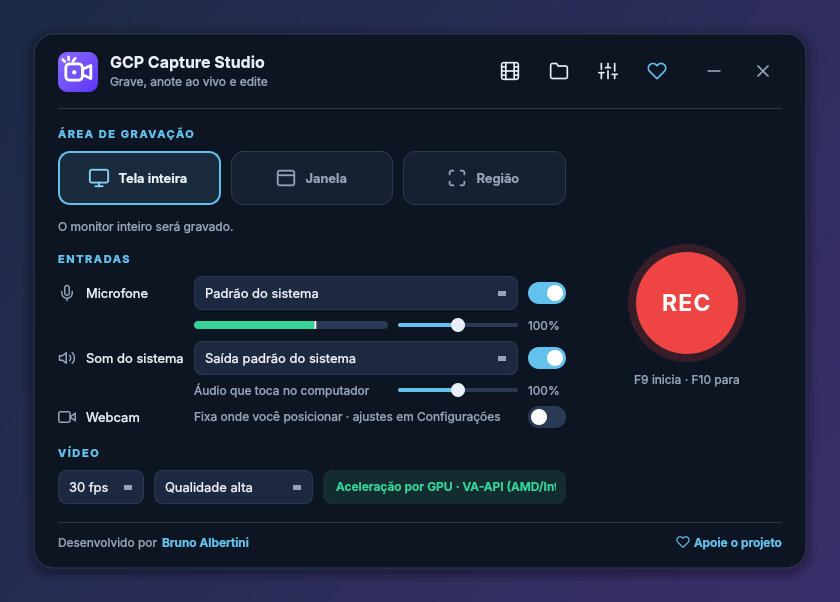
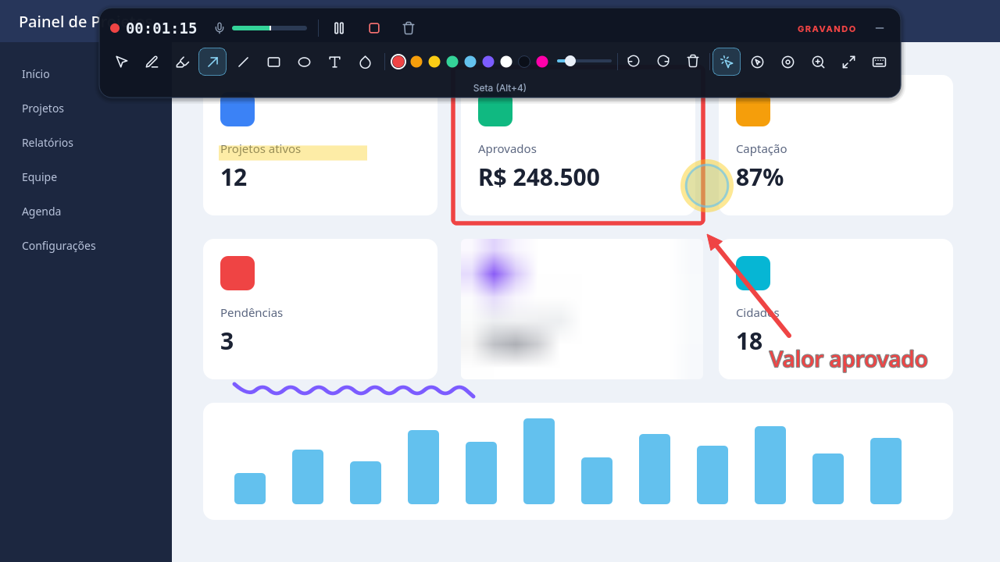
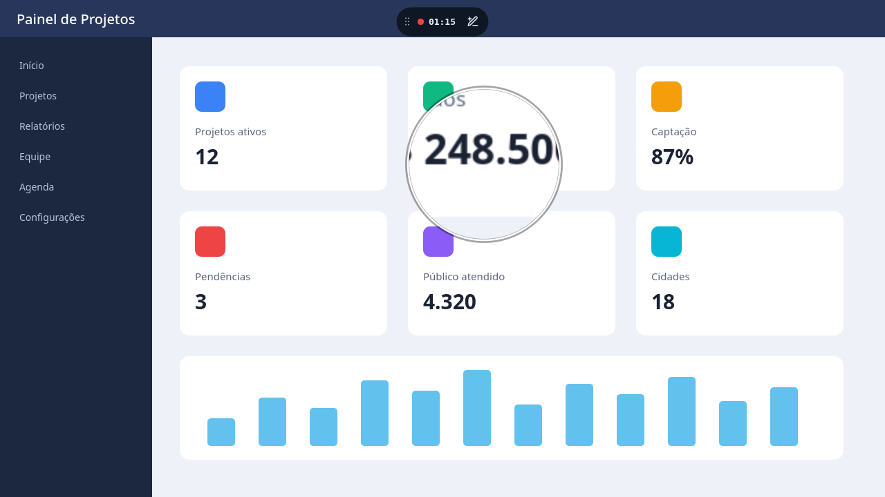
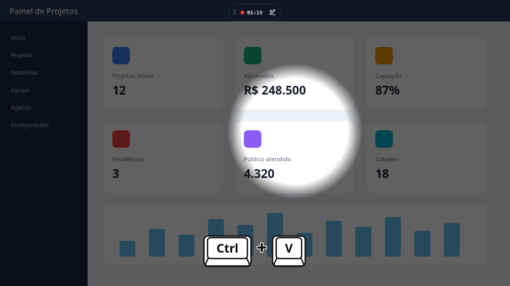
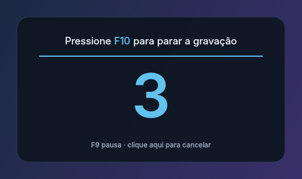
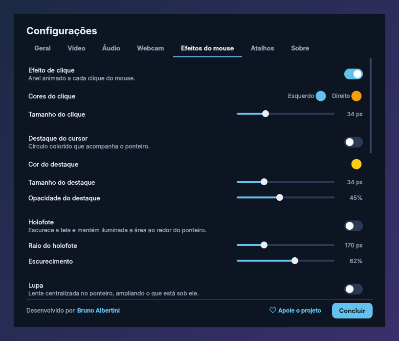
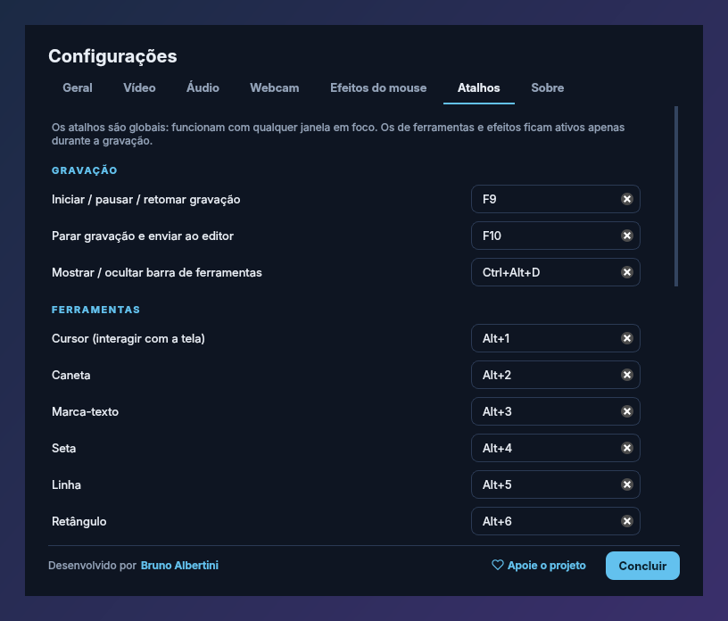
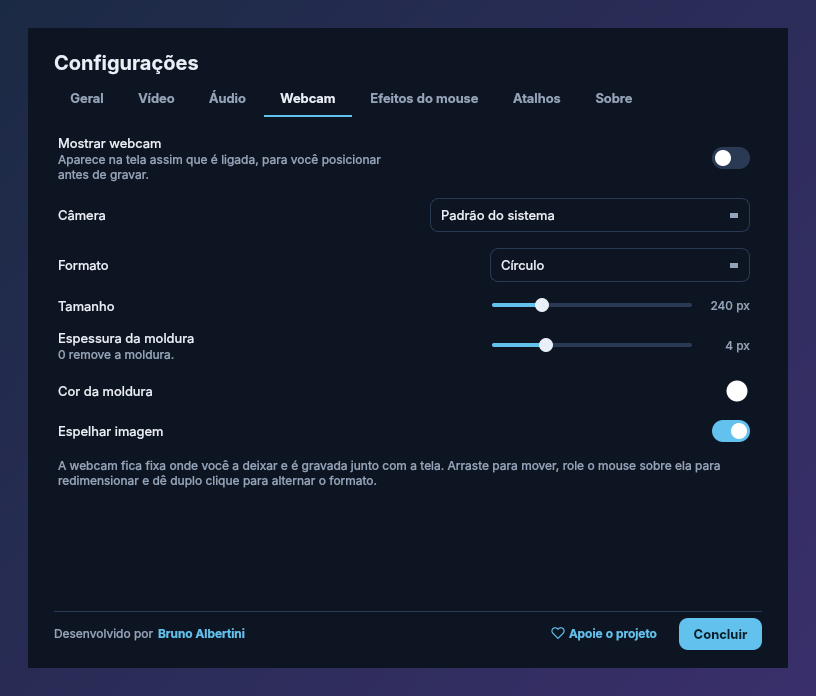
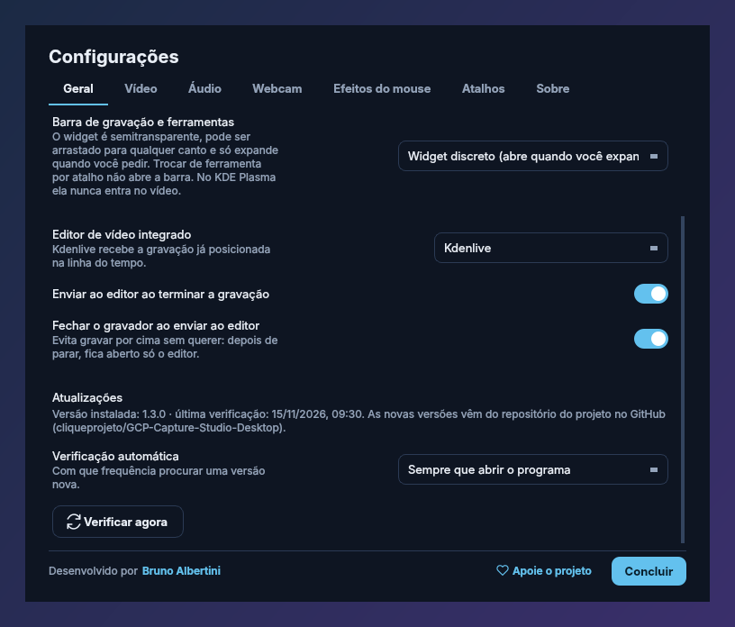
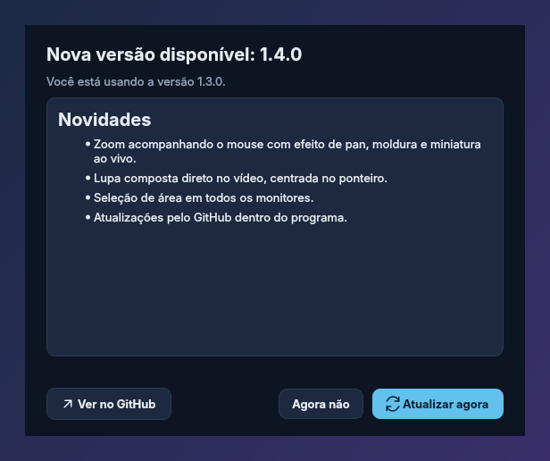

# GCP Capture Studio

**Gravador de tela com desenhos, lupa, zoom e efeitos do mouse em tempo real — e a gravação já chega pronta na linha do tempo do editor de vídeo.**

O GCP Capture Studio foi feito para quem grava aulas, tutoriais e apresentações: você escolhe a área, ajusta microfone e som do sistema, aperta gravar e anota na tela enquanto fala. Tudo o que você desenha e destaca entra no vídeo na hora, sem etapa de pós-produção. Ao parar, a gravação abre no editor (Kdenlive) já posicionada na linha do tempo. Interface em português, sem cadastro, e seus vídeos ficam no seu computador.

Desenvolvido por **Bruno Albertini | [Gestão Cultural Pro](https://gestaoculturalpro.com.br/)**.



## Telas

| | |
|---|---|
| <br>**Anotar ao vivo** — caneta, marca-texto, seta, formas, texto e desfoque, com a barra de ferramentas fora do vídeo | <br>**Lupa** — centrada no ponteiro, ampliando o que está sob ele |
| <br>**Teclas e holofote** — atalhos pressionados aparecem em teclas animadas | <br>**Contagem regressiva** — com os atalhos de parar e pausar |
| <br>**Efeitos do mouse** — clique, destaque, holofote, lupa, zoom e teclas | <br>**Atalhos** — todos personalizáveis, com restauração do padrão |
| <br>**Webcam** — círculo, oval, quadrado ou 16:9, com moldura | <br>**Atualizações** — direto do GitHub, na frequência que você escolher |

## Baixar

Baixe a versão mais recente na página de [versões publicadas](https://github.com/cliqueprojeto/GCP-Capture-Studio-Desktop/releases/latest):

- **gcp-capture-studio-x.y.z-1-any.pkg.tar.zst** — BigLinux, Manjaro e Arch Linux: abra o arquivo pelo gerenciador de arquivos (Pamac) ou use `sudo pacman -U ./gcp-capture-studio-x.y.z-1-any.pkg.tar.zst`.
- **GCP-Capture-Studio-x.y.z-linux-all.deb** — Debian 13, Ubuntu 24.04 e derivados: `sudo apt install ./GCP-Capture-Studio-x.y.z-linux-all.deb`.
- **GCP-Capture-Studio-x.y.z-linux-noarch.rpm** — Fedora e distribuições compatíveis: `sudo dnf install ./GCP-Capture-Studio-x.y.z-linux-noarch.rpm`.
- **GCP-Capture-Studio-x.y.z-Windows-x64.exe** — Windows 10 (versão 2004 ou mais nova) e Windows 11, 64 bits.

Os pacotes Linux instalam o gravador e trazem o editor Kdenlive como dependência ou recomendação. Os hashes SHA-256 de todos os arquivos ficam em `SHA256SUMS.txt` na própria versão.

**Situação de cada sistema.** O programa é desenvolvido e testado no BigLinux com KDE Plasma (Wayland). Os pacotes `.deb` e `.rpm` são gerados e têm as dependências conferidas automaticamente a cada versão, mas ainda não foram testados em uso real nessas distribuições. A versão para **Windows é a primeira** e também ainda não foi testada em máquinas reais: captura, atalhos globais, efeitos e áudio foram escritos para o Windows, com as limitações listadas abaixo. Relatos são bem-vindos na aba [Issues](https://github.com/cliqueprojeto/GCP-Capture-Studio-Desktop/issues).

Como o instalador do Windows não tem assinatura digital de código, o sistema pode mostrar "O Windows protegeu o computador". Clique em **Mais informações** e depois em **Executar assim mesmo**. No Windows, instale também o [Kdenlive](https://kdenlive.org/pt-br/download/) para a edição.

## O que ele faz

### Gravar
- **Tela inteira, janela ou região**, com seleção em todos os monitores ao mesmo tempo — cada monitor aparece identificado pelo nome e a área pode ser marcada em qualquer um.
- Contagem regressiva configurável, **pausar e retomar** sem perder a gravação e opção de descartar.
- **Aceleração por GPU quando disponível** (VA-API em AMD/Intel, NVENC, Quick Sync, Media Foundation), com queda automática para CPU se a GPU falhar. Um teste de desempenho nas configurações mostra o que cada codificador rende na sua máquina.
- 15, 24, 30 ou 60 quadros por segundo e quatro níveis de qualidade.
- Resultado em **MP4 (H.264 + AAC)**, pronto para editar ou publicar.
- Monitores com escala (por exemplo, notebook a 125%) são gravados na resolução real.

### Áudio
- **Microfone e som do sistema** ao mesmo tempo, cada um com volume próprio.
- Microfones internos, headsets e interfaces de áudio USB (no Linux, com escolha do dispositivo).
- Medidor de nível em tempo real e **teste de microfone**: grava alguns segundos e reproduz para você ouvir.

### Anotar em tempo real
- Caneta, marca-texto, seta, linha, retângulo, elipse, **texto** e **desfoque** de áreas sensíveis.
- Cores, espessura do traço, desfazer, refazer e limpar tudo.
- Tudo o que é desenhado **entra no vídeo na hora**.
- A **barra de ferramentas nunca aparece no vídeo**: fica como um widget discreto que você arrasta para qualquer canto e só expande quando quer. Trocar de ferramenta por atalho não abre a barra.
- Ao passar o mouse sobre um item da barra, o **nome e o atalho** aparecem na própria barra.

### Efeitos do mouse
- **Efeito de clique** (cores diferentes para botão esquerdo e direito) e **destaque do cursor**.
- **Holofote**: escurece a tela e ilumina a região do ponteiro.
- **Lupa** centrada exatamente no ponteiro, com tamanho e ampliação ajustáveis.
- **Zoom acompanhando o mouse**, com efeito de *pan*: o vídeo aproxima e desliza suavemente para manter em foco o que está perto do ponteiro. Uma moldura na tela mostra a área enquadrada e uma miniatura ao vivo mostra o resultado — nenhuma das duas entra no vídeo.
- **Combinações de teclas na tela**: atalhos como `Ctrl + V` aparecem em teclas animadas enquanto são pressionados e somem suavemente, com estilo, tamanho e duração ajustáveis. Digitação comum (inclusive senhas) nunca é exibida.

### Webcam
- Janela flutuante em **círculo, oval, quadrado ou 16:9**, com moldura de cor e espessura ajustáveis e espelhamento.
- Fica **fixa onde você posicionar**: arraste para mover, role o mouse para redimensionar, duplo clique alterna o formato.

### Editar
- Ao parar, a gravação é enviada ao **Kdenlive** já na linha do tempo, com vídeo e áudio agrupados e o projeto no formato exato do vídeo.
- Depois de enviar, o gravador se encerra para que nenhuma tecla inicie outra gravação enquanto você edita (opcional).
- Shotcut e OpenShot também são reconhecidos como editores alternativos.

### Atalhos
Todos os atalhos são **globais** (funcionam com qualquer janela em foco), personalizáveis em **Configurações › Atalhos** e podem ser restaurados para o padrão.

| Ação | Atalho padrão |
|---|---|
| Iniciar, pausar e retomar | `F9` |
| Parar e enviar ao editor | `F10` |
| Abrir ou recolher a barra de ferramentas | `Ctrl+Alt+D` |
| Cursor, caneta, marca-texto, seta, linha, retângulo, elipse, texto, desfoque | `Alt+1` … `Alt+9` |
| Limpar desenhos · desfazer · refazer | `Alt+0` · `Ctrl+Alt+Z` · `Ctrl+Alt+Y` |
| Lupa · holofote · destaque · clique · teclas | `Ctrl+Alt+L` · `S` · `H` · `C` · `K` |
| Zoom acompanhando o mouse · aumentar · diminuir | `Ctrl+Alt+X` · `Ctrl+Alt+=` · `Ctrl+Alt+-` |

### Atualizações
Por padrão, o programa verifica se há versão nova no GitHub ao abrir. Em **Configurações › Geral › Atualizações** você escolhe a frequência (sempre que abrir, uma vez por dia, uma vez por semana ou nunca) ou clica em **Verificar agora**. Havendo versão nova, o programa mostra as novidades, baixa o pacote do seu sistema, confere o SHA-256 e instala — no Linux, o sistema pede a sua senha.



## Requisitos e limites

**Linux**
- Funciona melhor no **KDE Plasma 6 (Wayland)**: é o ambiente em que a barra, a lupa na tela e a moldura do zoom ficam fora do vídeo, os atalhos são globais e o ponteiro é acompanhado com precisão.
- Em outros ambientes Wayland (GNOME, por exemplo) a gravação usa o portal de captura do sistema; a barra é ocultada quando cairia dentro da área gravada, e a lupa e o zoom aparecem só no vídeo.
- Para os efeitos de clique e de teclas, o usuário precisa pertencer ao grupo `input` (padrão no BigLinux e no Manjaro).
- Na primeira gravação em cada monitor, o sistema pede autorização para compartilhar a tela; depois disso a escolha é lembrada.

**Windows (primeira versão)**
- Tela inteira e região; a gravação por janela usa a seleção por região.
- Microfone e som do sistema usam os **dispositivos padrão** do Windows.
- A exclusão da barra e da lupa do vídeo requer Windows 10 versão 2004 ou mais nova.

**Geral**
- O zoom acompanhando o mouse é aplicado no vídeo gravado; a sua tela continua normal, com a moldura e a miniatura como referência.
- macOS ainda não é suportado.

## Privacidade

As gravações são feitas e salvas no seu computador. O GCP Capture Studio não exige conta e não envia vídeos, áudio nem dados de uso para servidores. A conexão com a internet só é usada para consultar e baixar atualizações no GitHub (pode ser desligada) e para abrir os links que você escolher. O mostrador de teclas lê apenas combinações com Ctrl, Alt ou Super e teclas especiais; nada é armazenado.

## Para desenvolvedores

O GCP Capture Studio é escrito em Python com Qt 6 (PySide6) e GStreamer; a captura usa PipeWire e o portal de desktop no Linux e Direct3D 11 no Windows.

```bash
python3 -m gcp_capture_studio            # roda a partir do código
python3 -m gcp_capture_studio --selftest # confere captura, codificadores e efeitos disponíveis
sh packaging/build-pkg.sh                # gera o .pkg.tar.zst (Arch/Manjaro/BigLinux)
sh packaging/build-linux.sh              # gera o .deb e o .rpm
```

| Pasta | Conteúdo |
|---|---|
| `gcp_capture_studio/engine` | Motor de gravação: portal/PipeWire, pipeline GStreamer, codificadores, áudio, efeitos compostos no vídeo |
| `gcp_capture_studio/ui` | Tela inicial, contagem, anotações, barra de gravação, webcam, configurações, atualização e apoio |
| `gcp_capture_studio/platform` | Integrações com o sistema: atalhos globais, ponteiro e janelas (KWin), cliques e teclas, Windows |
| `gcp_capture_studio/editor` | Geração do projeto do Kdenlive e abertura do editor |
| `gcp_capture_studio/updater.py` | Verificação e instalação de atualizações pelo GitHub |
| `packaging` | Receitas dos pacotes Linux e do instalador do Windows |

Os instaladores de cada versão são gerados pelo workflow [Instaladores](.github/workflows/release.yml) ao publicar uma tag `vX.Y.Z`: ele monta os pacotes Linux, instala o `.deb` e o `.rpm` em contêineres para conferir as dependências, gera o instalador do Windows e publica tudo na versão, com os hashes. O histórico de mudanças fica em [HISTORICO.md](HISTORICO.md).

Sugestões e problemas podem ser enviados na aba [Issues](https://github.com/cliqueprojeto/GCP-Capture-Studio-Desktop/issues).

## Apoie o projeto

O GCP Capture Studio é gratuito. Se ele for útil para você, considere apoiar o desenvolvimento pelo botão **Apoie o projeto** dentro do programa (PIX ou Stripe).

## Licença

**Software livre — GPL-3.0-or-later.**

**Autoria:** Bruno Albertini | Gestão Cultural Pro.

O GCP Capture Studio é software livre: você pode redistribuí-lo e modificá-lo sob os termos da **GNU General Public License, versão 3 ou posterior**, publicada pela Free Software Foundation. Ele é distribuído na esperança de ser útil, mas **sem nenhuma garantia**. Veja o arquivo [LICENSE](LICENSE).

Qt, GStreamer, FFmpeg, x264 e Kdenlive são projetos de terceiros e mantêm suas próprias licenças.
